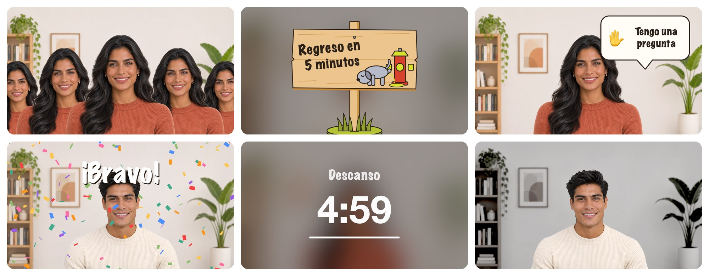
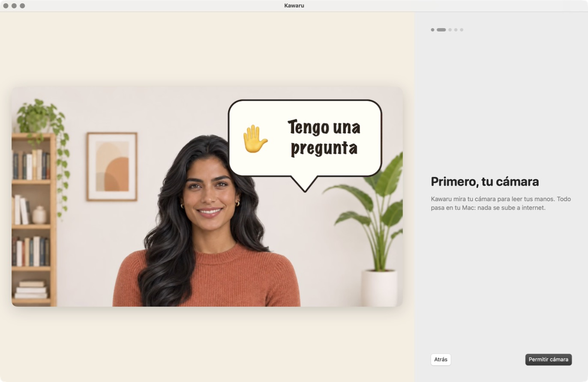

<p align="center">
  <a href="README.md">Español</a> · <b>English</b> · <a href="README.pt-BR.md">Português</a> · <a href="README.fr.md">Français</a> · <a href="README.ja.md">日本語</a> · <a href="README.zh-Hans.md">简体中文</a> · <a href="README.ko.md">한국어</a>
</p>

<p align="center">
  
</p>

<h1 align="center">Kawaru</h1>

<p align="center">
  <b>Your video call, with a gesture.</b><br>
  Pro-looking effects and captions over your camera, in Meet, Zoom, Teams, or anywhere else.<br>
  Raise your hand and it happens. No keyboard, no screen sharing, nothing leaves your Mac.
</p>

<p align="center">
  <a href="https://github.com/fsaldivar-dev/kawaru/releases/latest/download/Kawaru-0.2.0.dmg"><b>Download for macOS</b></a>
  &nbsp;·&nbsp;
  <a href="docs/guia.en.md">User guide</a>
  &nbsp;·&nbsp;
  macOS 14 or later
</p>

<p align="center">
  
</p>

---

## Stop asking "Can everyone hear me?" and start making an entrance

On a call, everyone is a little box with a name in tiny type. Kawaru gives your picture what a TV show
gives its host: your name and title, today's topic, your socials, a "back in five minutes" when you
step away.

And it does it when you make a hand sign. The camera reads your hand, you keep talking.

## Captions that look straight out of a studio

<p align="center">
  
</p>

- **Five types:** a lower third with your name, a banner with the topic, a badge ("Live", "Recording"),
  a full-screen card ("Starting Soon"), and your social handles with their logos.
- **Five themes:** Minimal, Corporate, Neon, and Wood, ready to go; plus Custom, where you pick the
  colors, font, and shape. Your brand, your style.
- **Several at once, no overlap:** show your name, your LinkedIn, and today's topic together; they arrange themselves.
- **Wherever you say:** drag the caption over the preview and that's where it stays.
- **With an entrance:** slide, fade in, bounce, or reveal. They stay until you remove them, or leave on their own.

## Effects that keep the meeting awake

<p align="center">
  
</p>

| Effect | What it's for |
|---|---|
| **Confetti** | Celebrate a team win on the spot, without hunting for the emoji. |
| **Question Bubble** | Ask to speak without interrupting whoever's talking. |
| **Away Sign** | Step away without anyone wondering if your connection dropped. |
| **Break** | An on-screen countdown: everyone knows when you're picking back up. |
| **Spotlight** | You in color, the background in gray. For when all eyes should be on you. |
| **Clones** and **Substitution** | Because not every meeting has to be serious. |

The text on the sign, the bubble, and the confetti is yours: write whatever you like.

## Your gestures, not ours

Kawaru comes with ready-made hand poses (thumbs up, open palm, two fingers…), but the best part is
**recording your own**: pose your hand any way you like, repeat it three times so it learns how you
make it, and that sign is yours. It saves a photo to help you remember it.

Hands full? Every effect and every caption also has its own **keyboard shortcut**, which works even when
the call is in front, and a button in the **menu bar icon**.

## Made for macOS

<p align="center">
  
  
</p>

- **You see what they'll see.** Every effect and caption is shown exactly as it will look in the call before you use it.
- **It teaches you the ropes.** A welcome tutorial and a guided tour of the window, step by step.
- **It stays out of your way.** It lives in the menu bar. Close the window and it's still ready for your next call.
- **It respects your camera.** It only turns it on when a call is using it; the rest of the time, it's off.

<p align="center">
  
  
</p>

## Your picture stays on your Mac

Kawaru has no servers, no accounts, no analytics. Your camera is processed on your own machine with
Apple's tools, and the only thing that goes out is what you send to your call. The only things saved to
disk, in your user folder, are the photos of the gestures you record and the icons you choose.

## Get started in three steps

1. **[Download Kawaru](https://github.com/fsaldivar-dev/kawaru/releases/latest/download/Kawaru-0.2.0.dmg)**,
   open the file, and drag it to Applications.
2. **Open it and follow the tutorial:** you allow camera access, install the virtual camera, and try your first gesture.
3. **In your video call app, choose the "Kawaru" camera.** Done.

The [user guide](docs/guia.en.md) covers everything in detail, including fixes for the most common hiccups.

## Status

This is version **0.2.0**. It's signed and notarized by Apple. The app speaks Spanish, English, Portuguese, French, Japanese, Simplified Chinese, and Korean: it uses your Mac's language (the screenshots on this page show the Spanish version). It has been tested on
a Mac running macOS 26; if something doesn't work for you, [open an issue](https://github.com/fsaldivar-dev/kawaru/issues)
and tell us which Mac and which version of macOS you have.

## For developers

Kawaru is a Swift package with no external dependencies. It uses Vision to read hands and cut out the
person, Core Image to composite, and a CoreMediaIO camera extension to show up as a camera
on the system.

```bash
scripts/provision.sh        # una vez: obtiene de Xcode el perfil para la cámara virtual
scripts/build.sh --install  # compila e instala en /Applications
```

You need Xcode with your developer account and `xcodegen` (`brew install xcodegen`). To publish a
signed and notarized release, see the comments in [`scripts/release.sh`](scripts/release.sh).
The app's text is written in Spanish and its translations live in `assets/idiomas`; `scripts/idiomas.sh`
checks that none are missing. `scripts/previews.sh` regenerates the gallery images by running the photos in `assets/modelo` through
the app's real compositor.

## Credits

Created by **Francisco Javier Saldivar Rubio** ·
[LinkedIn](https://www.linkedin.com/in/fsaldivar-dev/) ·
[GitHub](https://github.com/fsaldivar-dev) ·
[fsaldivar.dev@gmail.com](mailto:fsaldivar.dev@gmail.com)

The code is released under the [MIT license](LICENSE).

The social network logos come from [Simple Icons](https://simpleicons.org) (CC0) and are trademarks of
their respective owners. The people in the images don't exist: they're AI-generated models, as are the
illustrations and the caption plates.
