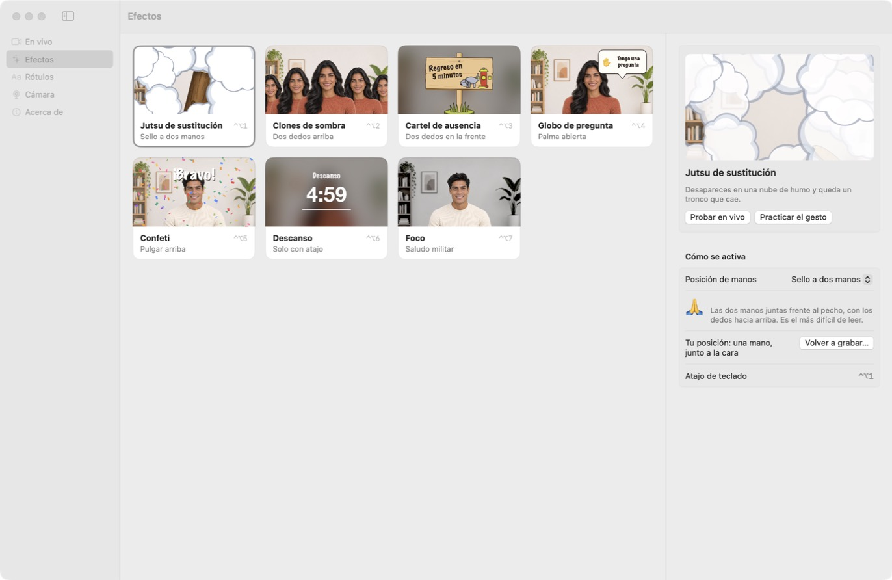

<p align="center">
  <a href="README.md">Español</a> · <a href="README.en.md">English</a> · <a href="README.pt-BR.md">Português</a> · <a href="README.fr.md">Français</a> · <a href="README.ja.md">日本語</a> · <a href="README.zh-Hans.md">简体中文</a> · <b>한국어</b>
</p>

<p align="center">
  
</p>

<h1 align="center">Kawaru</h1>

<p align="center">
  <b>화상 통화를 제스처 하나로.</b><br>
  Meet, Zoom, Teams 어디서든 카메라 화면 위에 방송 같은 효과와 자막을 올리세요.<br>
  손만 들면 됩니다. 키보드를 만질 필요도, 화면을 공유할 필요도, Mac 밖으로 나갈 필요도 없습니다.
</p>

<p align="center">
  <a href="https://github.com/fsaldivar-dev/kawaru/releases/latest/download/Kawaru-0.2.0.dmg"><b>macOS용 다운로드</b></a>
  &nbsp;·&nbsp;
  <a href="docs/guia.ko.md">사용 설명서</a>
  &nbsp;·&nbsp;
  macOS 14 이상
</p>

<p align="center">
  
</p>

---

## ‘제 목소리 들리세요?’는 그만, 이제 제대로 등장하세요

화상 통화에서는 누구나 작은 글씨로 이름이 적힌 네모 한 칸일 뿐입니다. Kawaru는 TV 프로그램이
진행자에게 해 주는 것을 여러분의 화면에 해 줍니다. 이름과 직함, 오늘의 주제, SNS 계정,
자리를 뜰 때의 ‘5분 뒤에 돌아올게요’까지.

그것도 손짓 한 번에. 카메라가 손을 읽는 동안 여러분은 하던 말을 계속하면 됩니다.

## 스튜디오에서 만든 듯한 자막

<p align="center">
  
</p>

- **다섯 가지 유형:** 이름이 들어가는 하단 자막, 주제를 알리는 배너, 배지(‘라이브’, ‘녹화 중’),
  전체 화면 카드(‘곧 시작합니다’), 그리고 로고가 함께 나오는 SNS 계정.
- **다섯 가지 테마:** 바로 쓸 수 있는 미니멀, 비즈니스, 네온, 우드, 그리고 색상과 서체, 모양을
  직접 고르는 사용자 설정. 내 브랜드를 내 스타일로.
- **여러 개를 동시에, 겹치지 않게:** 이름, LinkedIn, 오늘의 주제를 한꺼번에 띄워도 알아서 자리를 잡습니다.
- **원하는 자리에:** 미리보기 위에서 자막을 드래그하면 그 자리에 고정됩니다.
- **등장도 멋지게:** 슬라이드, 페이드 인, 바운스, 닦아내기. 직접 끌 때까지 남아 있거나, 알아서 사라집니다.

## 회의가 졸리지 않게 해 주는 효과

<p align="center">
  
</p>

| 효과 | 이럴 때 쓰세요 |
|---|---|
| **색종이** | 팀의 성과를 그 자리에서 축하할 때. 이모티콘을 찾을 필요가 없습니다. |
| **질문 말풍선** | 말하는 사람을 끊지 않고 발언 기회를 얻고 싶을 때. |
| **자리 비움 팻말** | 자리를 떠도 ‘연결이 끊겼나?’ 하는 사람이 없도록. |
| **휴식** | 화면에 카운트다운이 뜨니, 언제 다시 시작하는지 모두가 압니다. |
| **스포트라이트** | 나는 컬러로, 배경은 흑백으로. 시선을 모아야 할 때. |
| **분신**과 **바꿔치기** | 모든 회의가 진지할 필요는 없으니까요. |

팻말, 말풍선, 색종이에 들어가는 문구는 여러분의 것입니다. 원하는 대로 쓰세요.

## 우리가 정한 제스처가 아닌, 나만의 제스처

Kawaru에는 바로 쓸 수 있는 손 모양(엄지 척, 펼친 손바닥, 두 손가락 등)이 들어 있지만, 가장 좋은 방법은
**나만의 손 모양을 등록**하는 것입니다. 원하는 대로 손 모양을 만들고, 세 번 반복해 내 손버릇을
익히게 하면, 그 손짓은 온전히 내 것이 됩니다. 잊지 않도록 사진도 저장해 둡니다.

손을 쓸 수 없나요? 모든 효과와 자막에는 **키보드 단축키**도 있어서 통화 앱이 맨 앞에 있어도
동작하고, **메뉴 막대 아이콘**에도 버튼이 있습니다.

## macOS를 위해 만들었습니다

<p align="center">
  
  
</p>

- **상대가 볼 화면을 먼저 봅니다.** 모든 효과와 자막을 통화에서 보일 모습 그대로 미리 확인할 수 있습니다.
- **쓰는 법을 알려 줍니다.** 시작 튜토리얼과 윈도우 둘러보기가 한 단계씩 안내합니다.
- **방해하지 않습니다.** 메뉴 막대에 머뭅니다. 윈도우를 닫아도 다음 통화를 위해 준비되어 있습니다.
- **카메라를 아낍니다.** 통화에서 사용할 때만 카메라를 켜고, 그 외에는 꺼 둡니다.

<p align="center">
  
  
</p>

## 내 영상은 내 Mac에만

Kawaru에는 서버도, 계정도, 분석 도구도 없습니다. 카메라 영상은 Apple의 기술로 여러분의 기기에서
처리되며, 밖으로 나가는 것은 여러분이 통화에 내보내는 화면뿐입니다. 디스크에는 등록한 제스처의
사진과 직접 고른 아이콘만 사용자 폴더에 저장됩니다.

## 세 단계면 시작

1. **[Kawaru를 다운로드](https://github.com/fsaldivar-dev/kawaru/releases/latest/download/Kawaru-0.2.0.dmg)**하고,
   파일을 열어 응용 프로그램 폴더로 드래그하세요.
2. **앱을 열고 튜토리얼을 따라 하세요.** 카메라 권한을 허용하고, 가상 카메라를 설치하고, 첫 번째 제스처를 해 봅니다.
3. **화상 통화 앱에서 ‘Kawaru’ 카메라를 선택하세요.** 끝입니다.

[사용 설명서](docs/guia.ko.md)에 모든 기능이 자세히 나와 있으며, 자주 겪는 문제의 해결 방법도 담겨 있습니다.

## 현재 상태

현재 버전은 **0.2.0**입니다. Apple의 서명과 공증을 받았습니다. 앱은 스페인어, 영어, 포르투갈어, 프랑스어, 일본어, 중국어 간체, 한국어를 지원하며 Mac의 언어를 따릅니다(이 페이지의 스크린샷은 스페인어 버전입니다). macOS 26이
설치된 Mac에서 테스트했습니다. 제대로 동작하지 않는 부분이 있으면 [이슈를 등록](https://github.com/fsaldivar-dev/kawaru/issues)하고
사용 중인 Mac과 macOS 버전을 알려 주세요.

## 개발자를 위한 정보

Kawaru는 외부 의존성이 없는 Swift 패키지입니다. 손을 읽고 사람을 분리하는 데 Vision을, 합성에
Core Image를, 시스템에 카메라로 나타나는 데 CoreMediaIO 카메라 확장 프로그램을 사용합니다.

```bash
scripts/provision.sh        # una vez: obtiene de Xcode el perfil para la cámara virtual
scripts/build.sh --install  # compila e instala en /Applications
```

개발자 계정이 등록된 Xcode와 `xcodegen`(`brew install xcodegen`)이 필요합니다. 서명과 공증을 거친
버전을 배포하려면 [`scripts/release.sh`](scripts/release.sh)의 주석을 참고하세요.
앱의 텍스트는 스페인어로 작성하며 번역은 `assets/idiomas`에 있습니다. `scripts/idiomas.sh`는
빠진 번역이 없는지 확인합니다. `scripts/previews.sh`는 `assets/modelo`의 사진을 앱의 실제 합성기에
통과시켜 갤러리 이미지를 다시 만듭니다.

## 크레딧

만든 사람: **Francisco Javier Saldivar Rubio** ·
[LinkedIn](https://www.linkedin.com/in/fsaldivar-dev/) ·
[GitHub](https://github.com/fsaldivar-dev) ·
[fsaldivar.dev@gmail.com](mailto:fsaldivar.dev@gmail.com)

코드는 [MIT 라이선스](LICENSE)로 공개됩니다.

SNS 로고는 [Simple Icons](https://simpleicons.org)(CC0)에서 가져왔으며 각 소유자의 상표입니다.
이미지 속 인물은 실존하지 않습니다. 일러스트와 자막 배경판과 마찬가지로 AI로 생성한 모델입니다.
