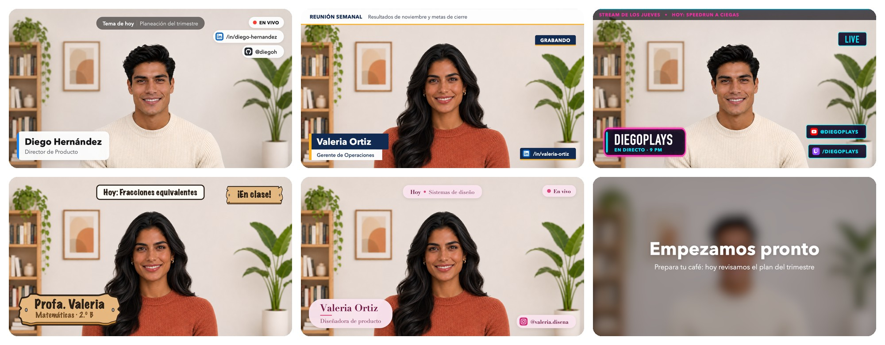

<p align="center">
  
</p>

<h1 align="center">Kawaru</h1>

<p align="center">
  <b>Tu videollamada, con un gesto.</b><br>
  Efectos y rótulos profesionales sobre tu cámara, en Meet, Zoom, Teams o donde sea.<br>
  Levantas la mano y pasa. Sin tocar el teclado, sin compartir pantalla, sin salir de tu Mac.
</p>

<p align="center">
  <a href="https://github.com/fsaldivar-dev/kawaru/releases/latest/download/Kawaru-0.1.0.dmg"><b>Descargar para macOS</b></a>
  &nbsp;·&nbsp;
  <a href="docs/guia.md">Guía de uso</a>
  &nbsp;·&nbsp;
  macOS 14 o posterior
</p>

<p align="center">
  
</p>

---

## Deja de decir «¿me escuchan?» y empieza a presentarte

En una llamada todos son un cuadrito con un nombre en letra pequeña. Kawaru le pone a tu imagen lo que
un programa de televisión le pone a su presentador: tu nombre y tu cargo, el tema del día, tus redes,
un «vuelvo en cinco minutos» cuando te levantas.

Y lo pone cuando tú haces una seña. La cámara lee tu mano, tú sigues hablando.

## Rótulos que se ven de estudio

<p align="center">
  
</p>

- **Cinco tipos:** tercio inferior con tu nombre, banner con el tema, insignia («En vivo», «Grabando»),
  tarjeta a pantalla completa («Empezamos pronto») y tus redes sociales con su logo.
- **Cinco temas:** Minimal, Corporativo, Neón y Madera, listos para usar; y Personalizado, donde eliges
  colores, tipo de letra y forma. Tu marca, tu estilo.
- **Varios a la vez, sin encimarse:** pon tu nombre, tu LinkedIn y el tema del día juntos; se acomodan solos.
- **Donde tú digas:** arrastra el rótulo sobre la vista previa y ahí se queda.
- **Con entrada:** deslizar, aparecer, rebote o revelar. Se quedan hasta que los quites, o se van solos.

## Efectos para que la reunión no se duerma

<p align="center">
  
</p>

| Efecto | Para qué sirve |
|---|---|
| **Confeti** | Celebrar un logro del equipo en el momento, sin buscar el emoji. |
| **Globo de pregunta** | Pedir la palabra sin interrumpir a quien habla. |
| **Cartel de ausencia** | Levantarte sin que nadie se pregunte si se te cayó la conexión. |
| **Descanso** | Una cuenta atrás en pantalla: todos saben cuándo se retoma. |
| **Foco** | Tú a color, el fondo en gris. Para cuando toca que te miren. |
| **Clones** y **Sustitución** | Porque no toda reunión tiene que ser seria. |

Los textos del cartel, el globo y el confeti son tuyos: escríbelos como quieras.

## Tus gestos, no los nuestros

Kawaru trae posiciones de mano listas (pulgar arriba, palma abierta, dos dedos…), pero lo mejor es
**grabar las tuyas**: pones la mano como quieras, la repites tres veces para que aprenda cómo te sale,
y esa seña es tuya. Guarda una foto para que la recuerdes.

¿Manos ocupadas? Cada efecto y cada rótulo tiene también su **atajo de teclado**, que funciona aunque la
llamada esté al frente, y un botón en el **icono de la barra de menús**.

## Hecha para macOS

<p align="center">
  
  
</p>

- **Ves lo que van a ver.** Cada efecto y cada rótulo se muestra tal como saldrá en la llamada antes de usarlo.
- **Te enseña a usarla.** Un tutorial de bienvenida y un recorrido guiado por la ventana, paso a paso.
- **No estorba.** Vive en la barra de menús. Cierra la ventana y sigue lista para tu próxima llamada.
- **Respeta tu cámara.** Solo la enciende cuando una llamada la está usando; el resto del tiempo, apagada.

<p align="center">
  
  
</p>

## Tu imagen se queda en tu Mac

Kawaru no tiene servidores, ni cuentas, ni analíticas. La cámara se procesa en tu equipo con las
herramientas de Apple y lo único que sale es lo que tú mandas a tu llamada. En disco solo se guardan,
en tu carpeta de usuario, las fotos de los gestos que grabas y los iconos que elijas.

## Empieza en tres pasos

1. **[Descarga Kawaru](https://github.com/fsaldivar-dev/kawaru/releases/latest/download/Kawaru-0.1.0.dmg)**,
   abre el archivo y arrástrala a Aplicaciones.
2. **Ábrela y sigue el tutorial:** das permiso a la cámara, instalas la cámara virtual y pruebas tu primer gesto.
3. **En tu app de videollamadas, elige la cámara «Kawaru».** Listo.

La [guía de uso](docs/guia.md) explica cada cosa con detalle, incluidas las soluciones a los tropiezos más comunes.

## Estado

Esta es la versión **0.1.0**, la primera pública. Está firmada y notarizada por Apple. Se ha probado en
una Mac con macOS 26; si algo no te funciona, [abre un reporte](https://github.com/fsaldivar-dev/kawaru/issues)
y cuéntanos qué Mac y qué versión de macOS tienes.

## Para desarrolladores

Kawaru es un paquete de Swift, sin dependencias externas. Usa Vision para leer las manos y recortar a la
persona, Core Image para componer, y una extensión de cámara de CoreMediaIO para aparecer como cámara
en el sistema.

```bash
scripts/provision.sh        # una vez: obtiene de Xcode el perfil para la cámara virtual
scripts/build.sh --install  # compila e instala en /Applications
```

Necesitas Xcode con tu cuenta de desarrollador y `xcodegen` (`brew install xcodegen`). Para publicar una
versión firmada y notarizada, mira los comentarios de [`scripts/release.sh`](scripts/release.sh).
`scripts/previews.sh` regenera las imágenes de la galería pasando las fotos de `assets/modelo` por el
compositor real de la app.

## Créditos

Creado por **Francisco Javier Saldivar Rubio** ·
[LinkedIn](https://www.linkedin.com/in/fsaldivar-dev/) ·
[GitHub](https://github.com/fsaldivar-dev) ·
[fsaldivar.dev@gmail.com](mailto:fsaldivar.dev@gmail.com)

Los logos de redes sociales vienen de [Simple Icons](https://simpleicons.org) (CC0) y son marcas de sus
respectivos dueños. Las personas de las imágenes no existen: son modelos generados con IA, igual que las
ilustraciones y las placas de los rótulos.
