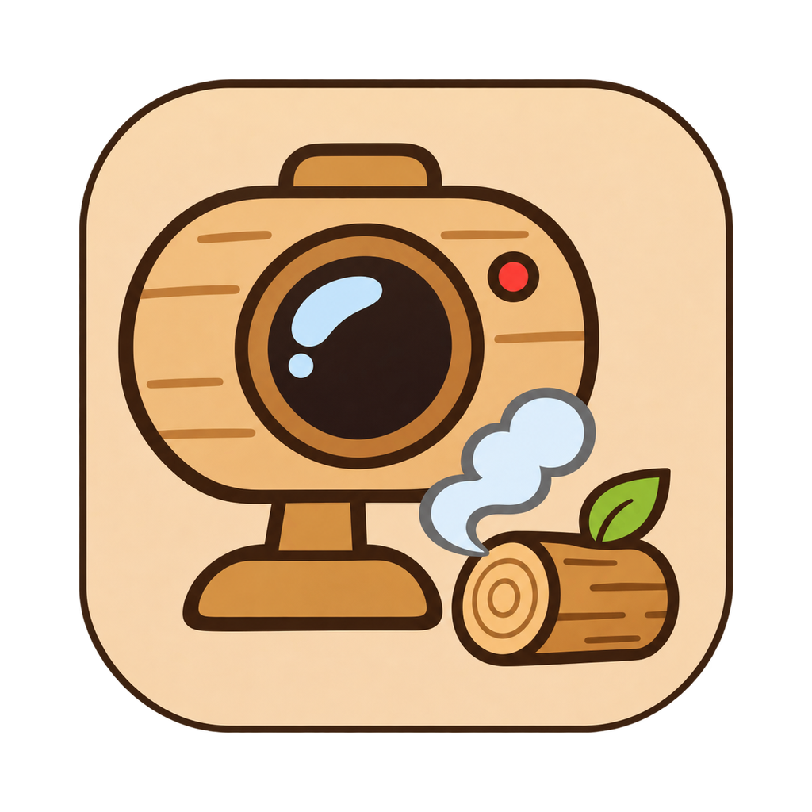

<p align="center">
  <a href="README.md">Español</a> · <a href="README.en.md">English</a> · <b>Português</b> · <a href="README.fr.md">Français</a> · <a href="README.ja.md">日本語</a> · <a href="README.zh-Hans.md">简体中文</a> · <a href="README.ko.md">한국어</a>
</p>

<p align="center">
  
</p>

<h1 align="center">Kawaru</h1>

<p align="center">
  <b>Sua videochamada, com um gesto.</b><br>
  Efeitos e letreiros profissionais sobre a sua câmera, no Meet, no Zoom, no Teams ou onde for.<br>
  Você levanta a mão e acontece. Sem tocar no teclado, sem compartilhar a tela, sem sair do seu Mac.
</p>

<p align="center">
  <a href="https://github.com/fsaldivar-dev/kawaru/releases/latest/download/Kawaru-0.2.0.dmg"><b>Baixar para macOS</b></a>
  &nbsp;·&nbsp;
  <a href="docs/guia.pt-BR.md">Guia de uso</a>
  &nbsp;·&nbsp;
  macOS 14 ou posterior
</p>

<p align="center">
  
</p>

---

## Pare de perguntar “estão me ouvindo?” e comece a se apresentar

Em uma chamada, todo mundo é um quadradinho com um nome em letra miúda. O Kawaru coloca na sua imagem o
que um programa de TV coloca no apresentador: seu nome e seu cargo, o tema do dia, suas redes, um
“volto em cinco minutos” quando você se levanta.

E coloca quando você faz um sinal. A câmera lê a sua mão, você continua falando.

## Letreiros com cara de estúdio

<p align="center">
  
</p>

- **Cinco tipos:** terço inferior com o seu nome, banner com o tema, selo (“Ao vivo”, “Gravando”),
  cartão em tela cheia (“Já vamos começar”) e suas redes sociais com o logo.
- **Cinco temas:** Minimalista, Corporativo, Neon e Madeira, prontos para usar; e Personalizado, em que
  você escolhe cores, fonte e formato. Sua marca, seu estilo.
- **Vários ao mesmo tempo, sem se atropelar:** coloque seu nome, seu LinkedIn e o tema do dia juntos; eles se ajeitam sozinhos.
- **Onde você quiser:** arraste o letreiro sobre a pré-visualização e ele fica ali.
- **Com entrada:** deslizar, surgir, quicar ou revelar. Ficam até você remover, ou saem sozinhos.

## Efeitos para a reunião não dar sono

<p align="center">
  
</p>

| Efeito | Para que serve |
|---|---|
| **Confete** | Comemorar uma conquista do time na hora, sem caçar o emoji. |
| **Balão de pergunta** | Pedir a palavra sem interromper quem está falando. |
| **Placa de ausência** | Levantar sem que ninguém fique achando que sua conexão caiu. |
| **Intervalo** | Uma contagem regressiva na tela: todo mundo sabe quando a reunião volta. |
| **Holofote** | Você em cores, o fundo em cinza. Para a hora em que precisam olhar para você. |
| **Clones** e **Substituição** | Porque nem toda reunião precisa ser séria. |

Os textos da placa, do balão e do confete são seus: escreva o que quiser.

## Seus gestos, não os nossos

O Kawaru já vem com posições de mão prontas (polegar para cima, palma aberta, dois dedos…), mas o melhor é
**gravar as suas**: você posiciona a mão como quiser, repete três vezes para ele aprender o seu jeito,
e esse sinal é seu. Ele guarda uma foto para você lembrar.

Mãos ocupadas? Cada efeito e cada letreiro também tem seu **atalho de teclado**, que funciona mesmo com a
chamada em primeiro plano, e um botão no **ícone da barra de menus**.

## Feito para o macOS

<p align="center">
  
  
</p>

- **Você vê o que os outros vão ver.** Cada efeito e cada letreiro aparece exatamente como vai sair na chamada, antes de você usar.
- **Ele ensina você a usar.** Um tutorial de boas-vindas e um tour guiado pela janela, passo a passo.
- **Não atrapalha.** Mora na barra de menus. Feche a janela e ele continua pronto para a sua próxima chamada.
- **Respeita a sua câmera.** Só a liga quando uma chamada está usando; no resto do tempo, desligada.

<p align="center">
  
  
</p>

## Sua imagem fica no seu Mac

O Kawaru não tem servidores, nem contas, nem analytics. A câmera é processada no seu computador com as
ferramentas da Apple, e a única coisa que sai é o que você envia para a sua chamada. Em disco só ficam
salvos, na sua pasta de usuário, as fotos dos gestos que você grava e os ícones que você escolhe.

## Comece em três passos

1. **[Baixe o Kawaru](https://github.com/fsaldivar-dev/kawaru/releases/latest/download/Kawaru-0.2.0.dmg)**,
   abra o arquivo e arraste o app para Aplicativos.
2. **Abra e siga o tutorial:** você dá permissão à câmera, instala a câmera virtual e testa seu primeiro gesto.
3. **No seu app de videochamadas, escolha a câmera “Kawaru”.** Pronto.

O [guia de uso](docs/guia.pt-BR.md) explica tudo em detalhes, incluindo as soluções para os tropeços mais comuns.

## Estado

Esta é a versão **0.2.0**. Está assinada e autenticada pela Apple. O app fala espanhol, inglês, português, francês, japonês, chinês simplificado e coreano: ele usa o idioma do seu Mac (as capturas de tela desta página mostram a versão em espanhol). Foi testado em
um Mac com macOS 26; se algo não funcionar, [abra um relato](https://github.com/fsaldivar-dev/kawaru/issues)
e conte qual é o seu Mac e a sua versão do macOS.

## Para desenvolvedores

O Kawaru é um pacote Swift, sem dependências externas. Usa o Vision para ler as mãos e recortar a
pessoa, o Core Image para compor a imagem e uma extensão de câmera do CoreMediaIO para aparecer como câmera
no sistema.

```bash
scripts/provision.sh        # una vez: obtiene de Xcode el perfil para la cámara virtual
scripts/build.sh --install  # compila e instala en /Applications
```

Você precisa do Xcode com a sua conta de desenvolvedor e do `xcodegen` (`brew install xcodegen`). Para publicar uma
versão assinada e autenticada, veja os comentários de [`scripts/release.sh`](scripts/release.sh).
Os textos do app são escritos em espanhol e suas traduções ficam em `assets/idiomas`; o `scripts/idiomas.sh`
verifica se não falta nenhuma. O `scripts/previews.sh` gera de novo as imagens da galeria, passando as fotos de `assets/modelo` pelo
compositor real do app.

## Créditos

Criado por **Francisco Javier Saldivar Rubio** ·
[LinkedIn](https://www.linkedin.com/in/fsaldivar-dev/) ·
[GitHub](https://github.com/fsaldivar-dev) ·
[fsaldivar.dev@gmail.com](mailto:fsaldivar.dev@gmail.com)

O código é publicado sob a [licença MIT](LICENSE).

Os logos das redes sociais vêm do [Simple Icons](https://simpleicons.org) (CC0) e são marcas de seus
respectivos donos. As pessoas das imagens não existem: são modelos gerados com IA, assim como as
ilustrações e as placas dos letreiros.
