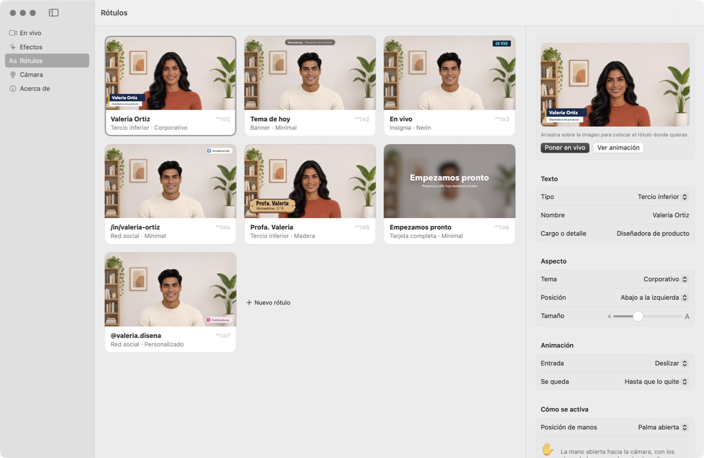

<p align="center">
  <a href="README.md">Español</a> · <a href="README.en.md">English</a> · <a href="README.pt-BR.md">Português</a> · <a href="README.fr.md">Français</a> · <a href="README.ja.md">日本語</a> · <b>简体中文</b> · <a href="README.ko.md">한국어</a>
</p>

<p align="center">
  
</p>

<h1 align="center">Kawaru</h1>

<p align="center">
  <b>一个手势，玩转视频通话。</b><br>
  在 Meet、Zoom、Teams 或任何地方，为你的摄像头画面加上专业级的特效和字幕条。<br>
  抬抬手就搞定。不用碰键盘，不用共享屏幕，一切都在你的 Mac 上完成。
</p>

<p align="center">
  <a href="https://github.com/fsaldivar-dev/kawaru/releases/latest/download/Kawaru-0.2.0.dmg"><b>下载 macOS 版</b></a>
  &nbsp;·&nbsp;
  <a href="docs/guia.zh-Hans.md">使用指南</a>
  &nbsp;·&nbsp;
  macOS 14 或更高版本
</p>

<p align="center">
  
</p>

---

## 别再只会问“大家听得到吗？”，是时候亮出你自己了

视频会议里，每个人都只是一个小方格，外加一行小字的名字。Kawaru 给你的画面加上的，正是电视节目给主持人配的那一套：你的姓名和职位、今天的主题、你的社交账号，还有起身离开时的那句“五分钟后回来”。

而且只要你比个手势，它就出现。摄像头读你的手，你接着说你的话。

## 演播室级别的字幕条

<p align="center">
  
</p>

- **五种类型：** 带姓名的人名条、展示主题的横幅、角标（“直播”“录制中”）、全屏卡片（“即将开始”），还有带平台标志的社交账号。
- **五套主题：** 极简、商务、霓虹和木纹，开箱即用；还有“自定义”，颜色、字体、形状都由你决定。你的品牌，你的风格。
- **多个同时显示，互不遮挡：** 姓名、LinkedIn 和今日主题一起上，它们会自动排好。
- **想放哪就放哪：** 在预览画面上拖动字幕条，它就留在那里。
- **自带入场动画：** 滑入、淡入、弹跳或展开。可以一直留着直到你移除，也可以到时间自动消失。

## 让会议不再昏昏欲睡的特效

<p align="center">
  
</p>

| 特效 | 用来做什么 |
|---|---|
| **撒花** | 团队有了好消息，当场庆祝，不用再翻表情。 |
| **提问气泡** | 想发言，又不打断正在说话的人。 |
| **离开告示牌** | 起身离开，没人会怀疑你是不是掉线了。 |
| **休息** | 屏幕上的倒计时：所有人都知道几点继续。 |
| **聚光灯** | 你是彩色的，背景变灰。轮到大家看你的时候用。 |
| **分身**和**替身** | 因为不是每场会议都得一本正经。 |

告示牌、气泡和撒花上的文字都归你管：想写什么就写什么。

## 你的手势，你说了算

Kawaru 自带几种现成的手型（竖大拇指、张开手掌、两指朝上……），但最棒的是**录制你自己的**：手想怎么摆就怎么摆，重复三次让它学会你的做法，这个手势就是你的了。它还会存一张照片，帮你记住。

手腾不开？每个特效和每个字幕条还有自己的**键盘快捷键**，即使通话窗口在最前面也能用；**菜单栏图标**里也有对应的按钮。

## 为 macOS 而生

<p align="center">
  
  
</p>

- **所见即所得。** 每个特效和字幕条在使用前，都会按通话中的真实效果展示给你看。
- **手把手教你用。** 一份欢迎教程，外加一步步带你认识窗口的导览。
- **不碍事。** 它住在菜单栏里。关掉窗口，它依然为你的下一场通话待命。
- **尊重你的摄像头。** 只有通话正在使用时才会开启，其余时间一律关闭。

<p align="center">
  
  
</p>

## 你的画面只留在你的 Mac 上

Kawaru 没有服务器，没有账号，也没有数据统计。摄像头画面用 Apple 提供的工具在你的电脑上处理，唯一会传出去的，就是你自己发到通话里的画面。磁盘上只会在你的用户文件夹中保存你录制手势时的照片和你选取的图标。

## 三步上手

1. **[下载 Kawaru](https://github.com/fsaldivar-dev/kawaru/releases/latest/download/Kawaru-0.2.0.dmg)**，打开文件，把它拖到“应用程序”。
2. **打开它，跟着教程走：** 允许使用摄像头，安装虚拟摄像头，试试你的第一个手势。
3. **在你的视频通话 App 中，选择“Kawaru”摄像头。** 完成。

[使用指南](docs/guia.zh-Hans.md)对每一项都有详细说明，包括常见问题的解决办法。

## 现状

当前版本为 **0.2.0**，已由 Apple 签名并公证。App 支持西班牙语、英语、葡萄牙语、法语、日语、简体中文和韩语，会跟随你 Mac 的语言（本页截图展示的是西班牙语版本）。目前已在一台运行 macOS 26 的 Mac 上测试过；如果遇到问题，欢迎[提交反馈](https://github.com/fsaldivar-dev/kawaru/issues)，并告诉我们你的 Mac 型号和 macOS 版本。

## 开发者须知

Kawaru 是一个 Swift 软件包，没有任何外部依赖。它用 Vision 识别手部并抠出人像，用 Core Image 合成画面，再通过 CoreMediaIO 相机扩展在系统中显示为一个摄像头。

```bash
scripts/provision.sh        # una vez: obtiene de Xcode el perfil para la cámara virtual
scripts/build.sh --install  # compila e instala en /Applications
```

你需要登录了开发者账号的 Xcode 和 `xcodegen`（`brew install xcodegen`）。要发布经过签名和公证的版本，请看 [`scripts/release.sh`](scripts/release.sh) 中的注释。
App 的文字以西班牙语编写，译文放在 `assets/idiomas` 中；`scripts/idiomas.sh` 会检查有没有遗漏。`scripts/previews.sh` 会把 `assets/modelo` 中的照片送进 App 真实的合成器，重新生成图库中的图片。

## 致谢

作者：**Francisco Javier Saldivar Rubio** ·
[LinkedIn](https://www.linkedin.com/in/fsaldivar-dev/) ·
[GitHub](https://github.com/fsaldivar-dev) ·
[fsaldivar.dev@gmail.com](mailto:fsaldivar.dev@gmail.com)

代码以 [MIT 许可证](LICENSE)发布。

社交平台的标志来自 [Simple Icons](https://simpleicons.org)（CC0），均为其各自所有者的商标。图片中的人物并不存在：他们是 AI 生成的模特，插图和字幕条的底板也是如此。
