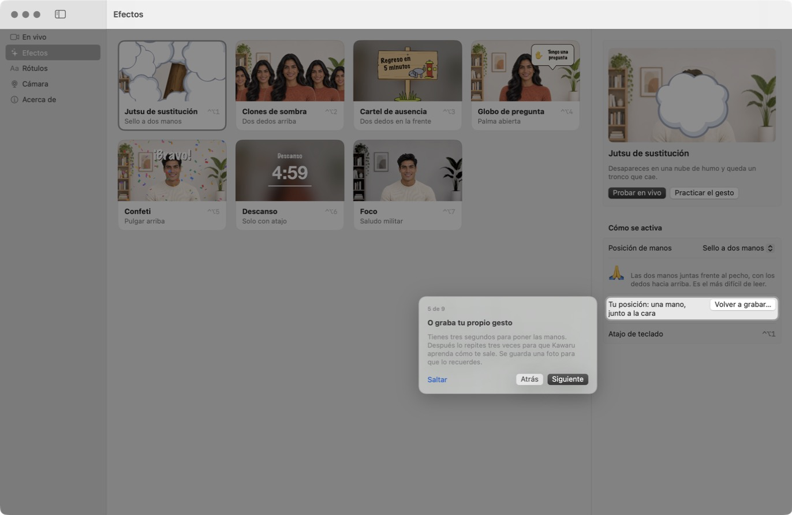

[Español](guia.md) · [English](guia.en.md) · [Português](guia.pt-BR.md) · [Français](guia.fr.md) · [日本語](guia.ja.md) · [简体中文](guia.zh-Hans.md) · **한국어**

# Kawaru 사용 설명서

설치부터 첫 통화까지, Kawaru를 제대로 활용하는 데 필요한 모든 것을 담았습니다.

- [설치하기](#설치하기)
- [시작 튜토리얼](#시작-튜토리얼)
- [통화에서 사용하기](#통화에서-사용하기)
- [효과](#효과)
- [자막](#자막)
- [제스처](#제스처)
- [키보드 단축키](#키보드-단축키)
- [메뉴 막대와 백그라운드 실행](#메뉴-막대와-백그라운드-실행)
- [배경 촬영하기](#배경-촬영하기)
- [문제가 생겼을 때](#문제가-생겼을-때)
- [개인정보 보호](#개인정보-보호)

## 설치하기

1. [릴리스 페이지](https://github.com/fsaldivar-dev/kawaru/releases/latest)에서 `Kawaru-0.2.0.dmg`를 다운로드하세요.
2. 파일을 열고 **Kawaru**를 **응용 프로그램** 폴더로 드래그하세요. 반드시 이 폴더에 있어야 합니다.
   macOS는 이 폴더에 있는 앱만 가상 카메라를 설치하도록 허용합니다.
3. 응용 프로그램 폴더에서 Kawaru를 여세요.

macOS 14 이상이 필요합니다. Kawaru는 Mac의 언어를 따릅니다. 스페인어, 영어, 포르투갈어, 프랑스어,
일본어, 중국어 간체, 한국어를 지원합니다.

## 시작 튜토리얼

처음 실행하면 Kawaru가 다섯 단계로 차근차근 안내합니다.

1. **소개.** Kawaru가 하는 일을 한눈에 봅니다.
2. **카메라.** ‘카메라 허용’을 누르고 macOS의 요청을 승인하세요.
3. **가상 카메라.** ‘가상 카메라 설치’를 누르세요. macOS에서 승인을 요청합니다.
   시스템 설정 › 일반 › 로그인 항목 및 확장 프로그램 › 카메라 확장 프로그램을 열고 Kawaru를 켜세요.
4. **첫 번째 제스처.** 카메라 앞에서 엄지를 세우고 0.5초 동안 유지하세요. Kawaru가 손에서 읽는
   지점들과, 인식할 때마다 하나씩 채워지는 표시 세 개가 보입니다.
5. **준비 완료.** 통화에서 사용하는 방법을 정리해 보여 줍니다.

튜토리얼이 끝나면 **윈도우 둘러보기**가 윈도우의 각 부분을 짚어 가며 용도를 알려 줍니다.

둘 다 **도움말** 메뉴에서 언제든지 다시 볼 수 있습니다.

## 통화에서 사용하기

Meet, Zoom, Teams 등 화상 통화 앱에서 카메라 설정을 열고 **Kawaru**를 선택하세요.
그때부터 다른 사람들은 여러분이 켠 효과와 자막이 적용된 화면을 보게 됩니다.

Kawaru 윈도우를 열어 둘 필요는 없습니다. 앱이 메뉴 막대에 있기만 하면 됩니다.

> Meet과 Zoom은 내 모습을 거울처럼 좌우 반전해서 보여 주기 때문에 내 자막이 뒤집혀 보입니다. 다른
> 사람들에게는 제대로 보입니다. 신경 쓰인다면 통화 앱 설정에서 ‘내 비디오 미러링’을 끄세요.

## 효과

**효과** 섹션에는 효과마다 카드가 하나씩 있습니다. 카드를 선택하면 오른쪽에 실제 효과의 비디오와
조정할 수 있는 항목이 나타납니다.

- **라이브로 사용해 보기:** 라이브 섹션에서 내 카메라 화면 위에 효과를 켭니다.
- **손 모양:** 효과를 켜는 제스처입니다. ‘없음’을 고르면 단축키로만 켤 수 있습니다.
- **나만의 손 모양:** 내 제스처를 등록합니다([제스처](#제스처) 참고).
- **텍스트 또는 시간**(해당하는 효과만): 팻말의 두 줄, 말풍선의 두 줄, 색종이의 문구, 휴식 시간(분).

효과를 켠 제스처를 다시 하면 효과가 꺼집니다. 색종이와 휴식은 끝나면 자동으로 사라집니다.

| 효과 | 설명 |
|---|---|
| 바꿔치기 | 연기 속으로 사라지고 통나무가 남습니다. [배경 촬영](#배경-촬영하기)이 필요합니다. |
| 분신 | 양옆에 분신이 나타납니다. |
| 자리 비움 팻말 | 내 문구가 적힌 팻말로 화면을 가립니다. |
| 질문 말풍선 | 내 옆에 말풍선이 뜹니다. |
| 색종이 | 색종이가 쏟아지고 문구가 나타납니다. |
| 휴식 | 전체 화면 카운트다운. |
| 스포트라이트 | 나는 컬러로, 배경은 흑백으로. |

## 자막

자막은 내 영상 위에 올라가는 텍스트입니다. 효과와 달리 **여러 개를 동시에** 띄울 수 있습니다.

### 자막 만들기

**새로운 자막**을 누르고 유형을 선택하세요.

- **하단 자막:** 이름과 직함.
- **배너:** 상단이나 하단에 들어가는 헤드라인.
- **배지:** 모서리에 붙는 짧은 라벨.
- **전체 화면 카드:** 화면을 가득 채우는 메시지.
- **SNS:** 플랫폼 로고와 사용자 이름.

### 내 스타일로 꾸미기

오른쪽 편집기에서 다음을 설정합니다.

- **텍스트:** 자막에 들어갈 내용.
- **테마:** 미니멀, 비즈니스, 네온, 우드 또는 **사용자 설정**. 사용자 설정에서는 배경 색상, 텍스트 색상,
  강조 색상과 일곱 가지 서체 중 하나, 모서리를 얼마나 둥글게 할지를 고릅니다.
- **위치:** 모서리 중 하나를 고르거나, **미리보기 위에서 드래그**해 원하는 곳에 놓으세요.
  ‘재설정’을 누르면 모서리로 돌아갑니다.
- **크기.**
- **등장 효과:** 슬라이드, 페이드 인, 바운스, 닦아내기. ‘애니메이션 보기’로 재생해 볼 수 있습니다.
- **표시 시간:** 직접 끌 때까지, 또는 5초에서 1분까지.

SNS 자막에서는 **이미지 선택…**으로 로고를 내 이미지로 바꿀 수 있습니다.

### 여러 개를 동시에

같은 모서리에 있는 자막은 켠 순서대로 겹치지 않게 쌓입니다. 드래그해서 배치한 자막은 놓아둔
자리에 그대로 있습니다.

### 켜고 끄기

**라이브에 표시** 버튼, 제스처, 단축키 또는 메뉴 막대에서 켜고 끌 수 있습니다.

## 제스처

제스처는 **0.5초** 남짓 유지하면 인식됩니다. 다시 사용하려면 먼저 **손을 내려야** 합니다. 같은
손 모양을 계속 유지하는 동안에는 반복해서 실행되지 않습니다.

### 기본으로 제공되는 제스처

이마에 두 손가락, 거수경례, 두 손가락 위로, 펼친 손바닥, 엄지 척, 양손 인 맺기.

### 나만의 제스처 등록하기

1. 효과나 자막에서 ‘나만의 손 모양’ 옆의 **등록…**을 누르세요.
2. 3초 안에 손 모양을 만드세요. Kawaru가 읽는 지점들이 보입니다. 보이지 않는다면 손을 인식하지 못한 것입니다.
3. 등록하는 동안 움직이지 마세요.
4. 중간중간 손을 내려 가며 **세 번 반복**하세요. 똑같이 따라 할 필요는 없습니다. 이 반복을 통해
   Kawaru가 여러분의 실제 손 모양을 익힙니다.

기억하기 쉽도록 제스처를 하고 있는 내 사진이 저장됩니다.

### 잘 인식되게 하는 요령

- 제스처마다 다른 제스처와 **확실히 구별**되게 하세요. 두 제스처가 비슷하면 Kawaru가 알려 줍니다.
- 한 손이 두 손보다 잘 인식됩니다. 두 손을 쓴다면 **서로 닿지 않게** 하세요. 붙어 있으면 한 손으로 보입니다.
- 정면에서 밝은 조명을 받고, 손이 화면 안에 들어오게 하세요.
- **제스처 연습하기**를 쓰면 아무것도 실행하지 않고 시험해 볼 수 있습니다.

## 키보드 단축키

통화 앱이 맨 앞에 있어도 동작합니다.

| 단축키 | 켜는 대상 |
|---|---|
| ⌃⌥1 … ⌃⌥7 | 효과(갤러리 순서) |
| ⌃⌥⇧1 … ⌃⌥⇧9 | 내 자막(목록 순서) |

## 메뉴 막대와 백그라운드 실행

Kawaru는 메뉴 막대에 아이콘을 둡니다. 여기에서 다음을 할 수 있습니다.

- 클릭 한 번으로 효과나 자막을 켜고 끄기.
- **손 제스처** 일시 정지(단축키와 버튼은 계속 사용할 수 있습니다).
- **로그인 시 열기** 켜기.
- 윈도우 열기 또는 종료.

윈도우를 닫아도 앱은 종료되지 않습니다. 윈도우가 닫혀 있을 때는 통화에서 ‘Kawaru’ 카메라를
사용하는 동안에만 카메라가 켜집니다.

## 배경 촬영하기

화면에서 나를 지우는 효과는 내 뒤에 무엇이 있는지 알아야 합니다. **카메라**에서 **배경 촬영**을
누르고 화면 밖으로 나가세요. 3초 뒤에 빈 배경을 촬영합니다. 사진은 메모리에만 보관됩니다.
카메라를 옮겼다면 다시 촬영하세요.

## 문제가 생겼을 때

**통화 앱에 ‘Kawaru’ 카메라가 나타나지 않습니다.**
카메라 섹션에 ‘가상 카메라 활성화됨’이라고 표시되는지 확인하세요. 통화 앱이 열려 있는 상태에서
설치했다면 통화 앱을 닫았다가 다시 여세요. Chrome에서는 브라우저를 완전히 종료해야 할 때도 있습니다.

**통화 앱에 Kawaru 앱을 열라는 카드가 표시됩니다.**
Kawaru가 실행 중이 아닙니다. 앱을 여세요. 메뉴 막대에 둔 채로 써도 됩니다.

**제스처가 인식되지 않습니다.**
‘제스처 연습하기’를 사용해 손의 지점들을 살펴보세요. 지점이 보이지 않으면 조명이 부족하거나 손이
화면 밖에 있는 것입니다. 지점은 보이는데 횟수가 올라가지 않으면 제스처를 다시 등록하세요.

**제스처를 했는데 다른 것이 실행됩니다.**
제스처 두 개가 너무 비슷합니다. 하나를 다른 손 모양으로 등록하세요.

**Meet이나 Chrome이 내가 고르지 않은 배경을 적용합니다.**
그 배경은 Kawaru가 아니라 브라우저가 적용한 것입니다. Chrome 자체의 비디오 효과와 macOS의 비디오 효과
(메뉴 막대의 초록색 카메라 아이콘)를 확인하세요.

**Kawaru 아이콘이 회색으로 보입니다.**
macOS의 아이콘 스타일 때문입니다(시스템 설정 › 모양). 모든 앱에 적용됩니다.

## 개인정보 보호

- 카메라 영상은 Mac에서 처리됩니다. Kawaru는 영상을 어디로도 보내지 않습니다.
- 계정도 분석 도구도 없습니다.
- `~/Library/Application Support/Kawaru`에는 등록한 제스처의 사진과 자막용으로 고른 아이콘이
  저장됩니다. 원할 때 언제든지 삭제하세요.
